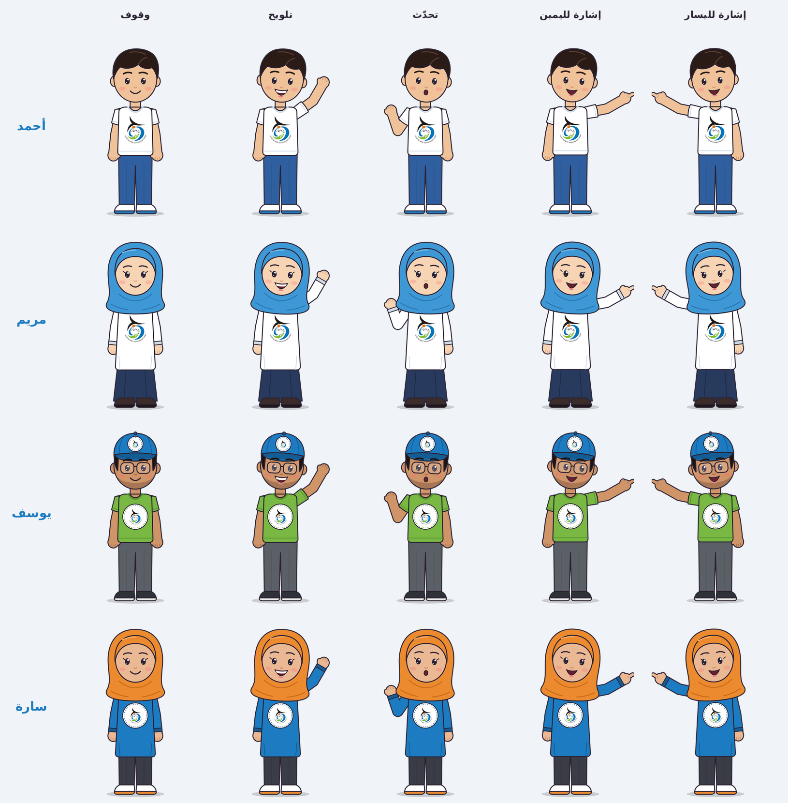

# شخصيات أنيميشن – إيثار وعطاء

أربع شخصيات كرتونية لمتطوعين شباب، ترتدي ملابس عليها شعار **الوكالة الوطنية للجهود التطوعية للشباب**، جاهزة للاستخدام في الفيديو والعروض التقديمية.



## الشخصيات

| الشخصية | الملابس | مكان الشعار |
|---|---|---|
| **أحمد** | قميص أبيض، جينز أزرق، حذاء رياضي | الشعار كبير على الصدر |
| **مريم** | حجاب أزرق، ثوب أبيض طويل، تنورة كحلية | الشعار كبير على الصدر |
| **يوسف** | قبعة زرقاء، نظارة، قميص أخضر، بنطال رمادي | رقعة دائرية على الصدر + على القبعة |
| **سارة** | حجاب برتقالي، ثوب أزرق طويل، حذاء أبيض | رقعة دائرية على الصدر |

ألوان الملابس مأخوذة من ألوان الشعار نفسه (الأزرق، الأخضر، البرتقالي).

## الحركات (لكل شخصية)

| اسم الملف | الحركة |
|---|---|
| `idle` | وقوف طبيعي مع تنفّس ورمش للعين |
| `wave` | تلويح باليد مع ابتسامة (للترحيب أو الوداع) |
| `talk` | تحدّث: الفم يتحرك مع حركة يد شارحة (للتعليق الصوتي) |
| `point-right` | إشارة إلى **يمين الشاشة** أثناء الكلام (لعرض نص أو صورة) |
| `point-left` | إشارة إلى **يسار الشاشة** أثناء الكلام |

كل حركة هي حلقة مدتها 4 ثوانٍ تتكرر بسلاسة، وملفات الفيديو مدتها 8 ثوانٍ (الحلقة مرتين). لتطويل المشهد كرّر المقطع في برنامج المونتاج.

## الملفات

| المجلد | المحتوى | الاستخدام |
|---|---|---|
| `videos/greenscreen/` | فيديو MP4 بخلفية خضراء (‎1080×1350) | **الأسهل**: يعمل في كل برامج المونتاج (CapCut، InShot، KineMaster، Premiere…) |
| `videos/transparent-webm/` | فيديو WebM بخلفية شفافة حقيقية | للبرامج التي تدعم الشفافية (DaVinci، Shotcut، Kdenlive، المتصفح) |
| `videos/gif/` | صور GIF متحركة شفافة | للعروض التقديمية PowerPoint ورسائل الواتساب |
| `characters/png/` | صور ثابتة شفافة عالية الدقة | للصور المصغرة، المنشورات، الشرائح |
| `characters/team.png` | صورة جماعية للشخصيات الأربع | للمقدمة أو الغلاف |
| `characters/svg/` | ملفات متجهة قابلة للتعديل | Illustrator / Inkscape لتغيير الألوان أو التفاصيل |
| `logo/logo-transparent.png` | الشعار بخلفية شفافة | لوضعه في الفيديو |

## طريقة الاستخدام في CapCut (الخلفية الخضراء)

1. ضع المشهد أو الخلفية في المسار الرئيسي.
2. اختر **Overlay / تراكب** ← أضف ملف الشخصية من `videos/greenscreen/`.
3. اختر **Remove background / إزالة الخلفية** ← **Chroma key** ← حدّد اللون الأخضر بأداة الالتقاط.
4. اضبط **Intensity / الشدّة** على قيمة منخفضة إلى متوسطة (حوالي 10–30) و**Shadow** حسب الحاجة.

> ⚠️ لا ترفع الشدّة كثيراً حتى لا يتأثر قميص **يوسف** الأخضر أو اللون الأخضر في الشعار.
> إذا كان برنامجك يدعم الشفافية فاستخدم ملفات WebM ولن تحتاج إلى Chroma key إطلاقاً.

- **Premiere Pro**: تأثير Ultra Key. **KineMaster / Filmora / InShot**: خاصية Chroma Key.
- **PowerPoint**: إدراج ← صورة ← اختر ملف GIF (يتحرك تلقائياً أثناء العرض).

## نصائح

- **لا تقلب الشخصية أفقياً (Flip / Mirror)** لأن الكتابة العربية في الشعار ستظهر معكوسة؛ استخدم `point-left` أو `point-right` حسب مكان النص في المشهد.
- لمشهد تعليق صوتي طويل: كرّر مقطع `talk`، ثم انتقل إلى `point-right` عند عرض معلومة على الشاشة.
- ابدأ الفيديو بـ `wave` للترحيب واختمه بـ `wave` للوداع.

## إعادة التوليد أو التعديل

الشخصيات مرسومة بالكود، ويمكن تعديل الألوان أو إضافة شخصية جديدة من قائمة `CHARACTERS` في `src/generate.py`، وتعديل الحركات في `src/anim.js`، ثم تشغيل:

```bash
bash src/build.sh
```

يحتاج إلى: Python 3 (Pillow و numpy)، Node.js مع Playwright و Chromium، و ffmpeg.
